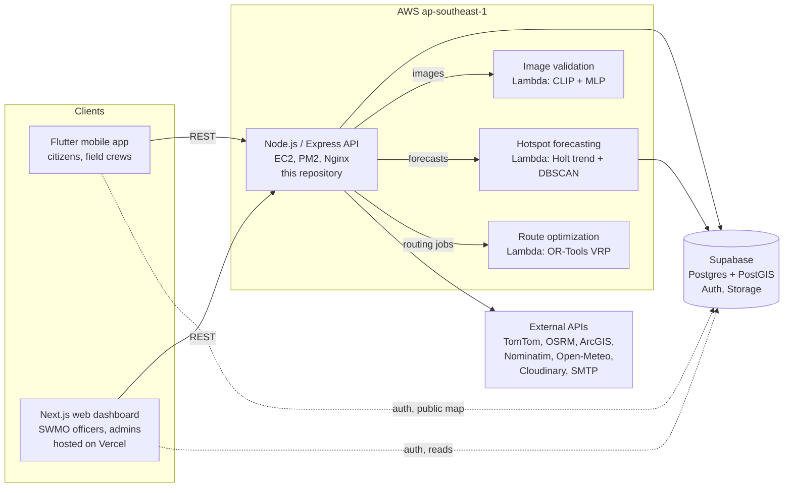
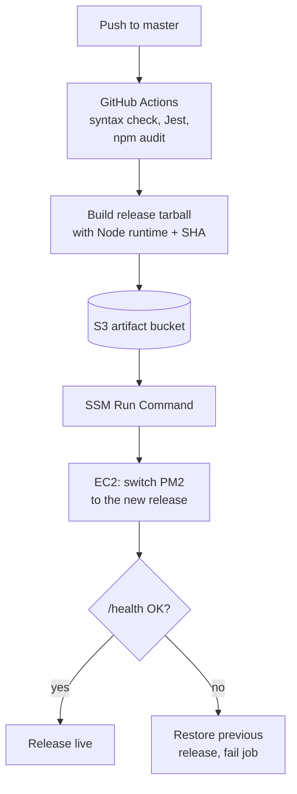

# EcoPin Backend API

**The Node.js/Express API behind EcoPin, a crowdsourced platform where Pasig City residents report environmental problems and the city's Solid Waste Management Office (SWMO) validates, clusters, and dispatches cleanup crews to them.**


EcoPin is our BSIT capstone project at Pamantasan ng Lungsod ng Pasig. This repository is the system's core: every report from the mobile app and every action on the officer dashboard goes through this API.

**Live dashboard:** [ecopin-web.vercel.app](https://ecopin-web.vercel.app) · **Android app:** [ecopin-web.vercel.app/downloads](https://ecopin-web.vercel.app/downloads)

<!-- Screenshot placeholder: add an image of the officer dashboard or a request flow GIF at docs/images/overview.png, then uncomment:

-->

## The EcoPin repositories

| Repository | What it is |
| --- | --- |
| **[ecopin_backend_node](https://github.com/klacom/ecopin_backend_node)** (you are here) | Node.js/Express REST API, background jobs, SQL migrations |
| [ecopin_app](https://github.com/klacom/ecopin_app) | Flutter mobile app for citizens and field crews |
| [ecopin_ml_models](https://github.com/klacom/ecopin_ml_models) | Python services: image validation, hotspot forecasting, route optimization |
| [ecopin-web](https://github.com/baldopadua/ecopin-web) | Next.js web dashboard for SWMO officers and administrators |

## Features

**Report intake and validation**
- Citizens submit reports with 1–5 photos (10 MB total), an optional short in-app video clip (5–10 seconds, configurable by admins), a map pin, and an optional anonymous flag.
- File checks before storage: magic-byte type validation, EXIF parsing, photo-location verification, and duplicate-photo detection.
- Every image is sent to the [image validation service](https://github.com/klacom/ecopin_ml_models). The result routes the report to **approved**, **manual review**, or **rejected**. Videos are split into frames with ffmpeg and each frame is classified.
- Outage-safe: if the classifier fails or times out, the report goes to manual review. It is never auto-rejected, and the uploaded evidence is kept.

**Prioritization and abuse controls**
- Citizens can mark a report Urgent. A per-citizen trust score (with an append-only decision ledger) locks Urgent after a human-confirmed false urgency claim.
- Strike system and per-user report quotas for abusive reporting.

**Clustering and dispatch**
- DBSCAN clustering of approved reports runs inside Postgres (`cluster_reports_incremental`) to merge duplicate reports of the same spot.
- Multi-criteria (MCDA) prioritization, crew assignment, and mixed-fleet route planning with vehicle capacity limits. Routes come from an OR-Tools vehicle-routing solver, with a greedy fallback.
- Travel times from TomTom or OSRM. Weather from Open-Meteo is factored into planning.
- A background planning worker and dispatch watchdog recover stalled planning jobs.

**Field operations**
- Offline-first sync API for field-crew devices: versioned writes, conflict detection, and merge resolution when a crew reconnects.
- Cleanup proof: up to 5 before photos and 5 after photos per report, officer review, and a public proof view for the citizen.

**Monitoring and analytics**
- Hotspot forecasting (7/30/90-day projections over an H3 hex grid) and historical hotspot patterns, served by the Python forecasting service.
- SLA breach detection and a 5-day escalation job for unprocessed reports, both run on cron.
- Per-barangay analytics, monthly executive-report data, a live operations feed, field-crew performance summaries, and an operational audit journal.

**Security and operations**
- Supabase Auth plus JWT verification, and role-based access control for four roles: `admin`, `officer`, `field_crew`, `citizen`.
- Email verification, password policy, Helmet headers, a CORS allowlist, and rate limiting.
- `/health` reports database, ffmpeg, and classifier status, plus the release commit SHA.
- A startup guard refuses to run against production data from a local machine.

## Tech stack

| Layer | Tools |
| --- | --- |
| Runtime | Node.js (ES modules), Express 5 |
| Data | Supabase (PostgreSQL + PostGIS, Auth, Storage), Redis (optional cache and quotas) |
| Media | Supabase Storage, Cloudinary, sharp, ffmpeg |
| Integrations | TomTom / OSRM routing, ArcGIS / Nominatim geocoding, Open-Meteo, SMTP (nodemailer) |
| Jobs | node-cron (SLA, escalation, forecasting, storage cleanup, planning worker) |
| Security | helmet, express-rate-limit, express-validator, jsonwebtoken, bcrypt |
| Testing | Jest 30, PGlite (embedded Postgres for migration tests) |
| Deployment | AWS EC2 (PM2 + Nginx), S3, SSM, GitHub Actions with OIDC |

## Architecture



The API owns all writes: report intake, validation results, clustering, dispatch, and sync. The mobile app and dashboard talk to Supabase directly only for sign-in and read-only public data. The three ML services run as container images on AWS Lambda (source in [ecopin_ml_models](https://github.com/klacom/ecopin_ml_models)). For local development each one can run as a plain HTTP server, selected with the `USE_AWS_*` flags.

### Deployment pipeline



GitHub Actions signs in to AWS with OIDC (no stored access keys). Pull requests run the checks without AWS access. Details are in [docs/aws-deployment.md](docs/aws-deployment.md).

### Data model

Work is organized top-down as **Workflow → Cleanup Task → Cluster → Report** (see [ARCHITECTURE.md](ARCHITECTURE.md)). A report is one citizen submission. Clusters group nearby reports. Cleanup tasks are dispatched units of crew work. Workflows group tasks for tracking.

## My role

EcoPin was built by a two-person team. I'm the main author of this repository (about 160 of its 235 commits). My work here:

- **Dispatch and route optimization:** designed and built most of the `optimization` module: MCDA prioritization, crew assignment, mixed-fleet planning, the planning worker and watchdog, and the OR-Tools VRP integration.
- **Database:** wrote 115 of the 125 SQL migrations, including the report lifecycle, offline-sync conflict handling, row-level access rules, audit-log immutability, and the citizen trust ledger.
- **ML integration:** connected the API to the image classifier and wrote the outage-recovery behavior (failures go to manual review instead of auto-reject).
- **Offline sync:** built the field-crew sync and conflict-resolution endpoints used by the mobile app.
- **Testing and CI/CD:** wrote most of the Jest suite and built the GitHub Actions → S3 → SSM → EC2 pipeline with automatic rollback.

My teammate **Charles Jeramy De Padua** led the hotspot forecasting integration (`spatial_forecast` module) and co-wrote the report, auth, and admin controllers. He also leads the [web dashboard](https://github.com/baldopadua/ecopin-web).

## Getting started

### Prerequisites

- **Node.js 20+** (CI runs Node 24) and npm
- **ffmpeg** on your `PATH` (used for video frame extraction; `/health` reports it)
- A **Supabase project with PostGIS**, preferably a local stack from the [Supabase CLI](https://supabase.com/docs/guides/local-development). Don't point local development at production. The server refuses to start against a known production database.
- Optional: **Redis** for caching and quotas, and the [ML services](https://github.com/klacom/ecopin_ml_models) for image validation, forecasting, and routing.
- On Linux, `canvas` needs `libcairo2-dev libpango1.0-dev libjpeg-dev libgif-dev librsvg2-dev`.

### Install and run

```bash
git clone https://github.com/klacom/ecopin_backend_node.git
cd ecopin_backend_node
npm install
cp .env.example .env      # then fill in your own local values
npm run dev               # nodemon on http://localhost:3000
```

Check that it's running:

```bash
curl http://localhost:3000/health
```

Run the test suite:

```bash
npm test -- --runInBand
```

### Database

The schema is tracked as plain SQL in [`migrations/`](migrations). The older un-prefixed files predate the timestamped series, and rollback scripts live in `migrations/rollback/`. There is no automatic migration runner: apply the files to your own isolated database, and read the matching note in [`docs/`](docs) before applying a feature migration.

### Environment variables

Copy [`.env.example`](.env.example) to `.env`. These are the keys the code reads. Never commit real values.

| Purpose | Keys |
| --- | --- |
| Server | `NODE_ENV`, `DEPLOYMENT_ENV`, `PORT`, `FRONTEND_URL`, `APP_BASE_URL`, `MOBILE_REDIRECT_URL` |
| Supabase | `SUPABASE_URL`, `DEVELOPMENT_SUPABASE_URL`, `SUPABASE_SECRET_KEY`, `SUPABASE_PUBLISHABLE_KEY` |
| Auth | `JWT_SECRET`, `JWT_EXPIRES_IN`, `JWT_ISSUER` |
| Rate limits | `RATE_LIMIT_WINDOW_MS`, `RATE_LIMIT_MAX_REQUESTS`, `OPS_RATE_LIMIT_MAX_REQUESTS` |
| Email | `SMTP_HOST`, `SMTP_PORT`, `SMTP_USER`, `SMTP_PASS`, `SMTP_FROM_NAME` |
| Image classifier | `CLASSIFIER_SERVICE_URL`, `USE_AWS_CLASSIFIER`, `AWS_CLASSIFIER_URL`, `EXP32_THRESHOLD`, `EXP32_REVIEW_LO`, `EXP32_REVIEW_HI` |
| Forecasting | `LOCAL_SPATIAL_FORECAST_SERVICE_URL`, `USE_AWS_SPATIAL_FORECAST`, `AWS_SPATIAL_FORECAST_SERVICE_URL`, `SPATIAL_ANALYTICS_TOKEN` |
| Route optimization | `LOCAL_VRP_SERVICE_URL`, `USE_AWS_VRP`, `AWS_VRP_SERVICE_URL`, `OPTIMIZATION_VRP_SOLVER`, `OPTIMIZATION_DIRECTIONS_PROVIDER`, `TOMTOM_API_KEY`, `OSRM_BASE_URL` |
| Geocoding | `ARCGIS_API_KEY`, `GEOCODING_USER_AGENT` |
| Media | `CLOUDINARY_CLOUD_NAME`, `CLOUDINARY_API_KEY`, `CLOUDINARY_API_SECRET` |
| Optional | `REDIS_URL`, `UNPROCESSED_ESCALATION_ENABLED`, `UNPROCESSED_ESCALATION_CRON`, `APM_PROVIDER`, `APM_ALERT_WEBHOOK_URL`, `APP_VERSION` |

## API at a glance

All routes are under `/api` and are rate limited. Most require a Supabase Auth access token and an allowed role.

| Prefix | Purpose |
| --- | --- |
| `/api/auth`, `/api/profile` | Registration, login, email verification, password changes, account deletion |
| `/api/reports` | Create reports, upload evidence, read details, cleanup proof, citizen trust review |
| `/api/manual-review`, `/api/strikes` | Officer review queue and reporter strikes |
| `/api/clusters` | Report clustering |
| `/api/optimization`, `/api/routing` | Dispatch planning, route generation, driving directions |
| `/api/cleanup-tasks`, `/api/fc`, `/api/response-logs` | Crew tasks, offline batch sync with conflict handling, crew response logs |
| `/api/spatial-forecast` | Hotspot forecasts and historical patterns |
| `/api/analytics`, `/api/operational-events`, `/api/sweeper` | Barangay analytics, live operations, SLA and audit |
| `/api/admin`, `/api/support`, `/api/contact`, `/api/media` | Administration, support tickets, contact form, private media delivery |

## Project structure

```text
ecopin_backend_node/
├── src/
│   ├── index.js            # server start-up and background jobs
│   ├── app.js              # Express app, middleware, route mounting, /health
│   ├── config/             # env config, Supabase/Cloudinary/email clients
│   ├── controllers/        # request handlers per feature
│   ├── routes/             # Express routers
│   ├── middleware/         # auth, RBAC, rate limiting, validation, quotas
│   ├── services/           # business logic and external clients
│   ├── modules/
│   │   ├── clustering/     # DBSCAN clustering
│   │   ├── optimization/   # prioritization, crew assignment, VRP, routing
│   │   ├── spatial_forecast/
│   │   └── sweeper/        # SLA detection, audit, analytics
│   └── jobs/               # cron jobs, planning worker, dispatch watchdog
├── migrations/             # SQL schema history (+ rollback/)
├── tests/                  # Jest suite
├── scripts/                # DB tooling, verification, deploy scripts
├── docs/                   # feature and operations notes
└── .github/workflows/      # CI/CD to AWS
```

## Team and credits

- **Klarenz Cobie O. Manrique** ([@klacom](https://github.com/klacom)): backend, mobile app, ML services, DevOps
- **Charles Jeramy C. De Padua** ([@baldopadua](https://github.com/baldopadua)): web dashboard, forecasting integration, backend
- **Adviser:** Greta M. Rosario, DIT

Capstone project, *EcoPin A.I.: Crowdsourced Geospatial Platform for Transparent Environmental Reporting and Rapid Institutional Detection for the Pasig City Solid Waste Management Office*. BS Information Technology, College of Computer Studies, Pamantasan ng Lungsod ng Pasig.

## Related repositories

- [klacom/ecopin_app](https://github.com/klacom/ecopin_app): Flutter mobile app
- [klacom/ecopin_ml_models](https://github.com/klacom/ecopin_ml_models): image validation, forecasting, and routing services
- [baldopadua/ecopin-web](https://github.com/baldopadua/ecopin-web): web dashboard ([live](https://ecopin-web.vercel.app))
