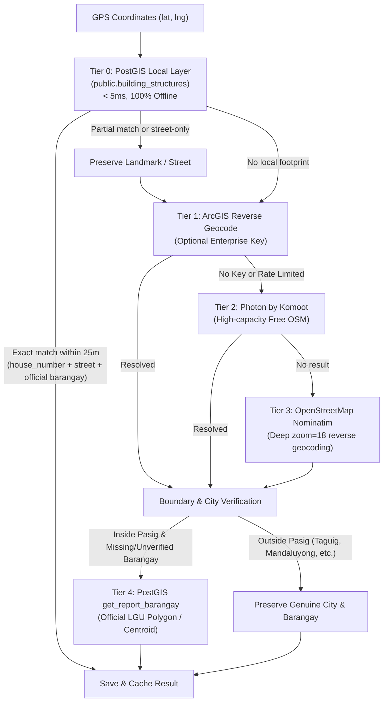

# PostGIS Building Footprints & Multi-Tier Geographic Address Resolution Architecture

## 1. Executive Summary & Purpose

EcoPin civic reports initially stored location data purely as raw geographic points (`POINT(lng lat)` in PostGIS EWKB / WKB hex), displaying coarse fallback strings such as `"Pasig City"`, broad barangay estimates, or unverified neighborhood tags (compounds, schools, subdivisions).

This feature establishes an authoritative, **100% free and open-source multi-tier address resolution pipeline** across the backend (`ecopin_backend_node`), web dashboard (`ecopin-web`), and mobile client (`ecopin_app`). It resolves raw GPS pins into high-fidelity civic street addresses with house numbers, street centerlines, recognized landmarks, and verified LGU barangays, while preserving authentic municipality boundaries for reports near or outside city borders.

---

## 2. Multi-Tier Resolution Hierarchy

Whenever a report is submitted or audited, the system resolves geographic coordinates through a deterministic 4-tier hierarchy:



### Tier 0: Local PostGIS Building Structures Layer (`public.building_structures`)
- **Latency**: `< 5ms` (local database index query, zero external HTTP dependencies).
- **Spatial Operator**: `ST_DWithin(boundary::geography, point::geography, buffer_meters)` combined with `ST_Distance`.
- **Dataset**: 4,346 verified building footprints strictly within Pasig City, plus verified institutional footprints (e.g., Pamantasan ng Lungsod ng Pasig / PLP main campus).
- **Output**: Numeric house number, street name, building/facility name, and official barangay.

### Tier 1: ArcGIS Enterprise Geocoder (Optional)
- Activated if `ARCGIS_API_KEY` is present in environment variables.
- Short-circuits with high-precision building-level coordinates.

### Tier 2: Photon by Komoot (High-Capacity OSM Reverse Geocoder)
- Free, open-source geocoding service based on OpenStreetMap Elasticsearch.
- Extracts `street`, `housenumber`, `locality`, `district`, and `city`.

### Tier 3: OpenStreetMap Nominatim (Fine-Grained OSM Reverse Geocoder)
- Deep `zoom=18` query with full address hierarchy (`quarter`, `suburb`, `village`, `neighbourhood`, `road`, `house_number`, `amenity`, `office`).
- Separates institutional amenities/offices from numeric door numbers to avoid concatenation glitches.

### Tier 4: Authoritative Pasig LGU Barangay Resolution (`public.get_report_barangay`)
- **Spatial Containment**: Checks polygon containment in `public.spatial_zones` (`zone_type = 'barangay'`).
- **Centroid Proximity**: Matches nearest of the 30 official Pasig barangay centroids.
- **Boundary Guard**: Only executed if the report is determined to be within Pasig City, preventing foreign coordinates from falling into border centroids.

---

## 3. Database Schema & PostGIS Functions

### Table: `public.building_structures`

```sql
CREATE TABLE IF NOT EXISTS public.building_structures (
  id uuid PRIMARY KEY DEFAULT gen_random_uuid(),
  house_number text,
  street_name text,
  barangay text,
  building_name text,
  source text DEFAULT 'qgis_import',
  centroid_lat double precision,
  centroid_lng double precision,
  boundary extensions.geometry(Geometry, 4326) NOT NULL,
  created_at timestamptz NOT NULL DEFAULT now()
);

-- Spatial GiST Index for sub-millisecond proximity queries
CREATE INDEX IF NOT EXISTS building_structures_geom_gist 
ON public.building_structures USING gist (boundary);
```

### Fast Proximity RPC: `public.get_structure_address(lat, lng, buffer_meters)`

```sql
CREATE OR REPLACE FUNCTION public.get_structure_address(
  lat double precision, 
  lng double precision,
  buffer_meters double precision DEFAULT 25.0
)
RETURNS TABLE (
  house_number text,
  street_name text,
  building_name text,
  barangay text,
  distance_meters double precision
)
LANGUAGE sql STABLE SECURITY DEFINER SET search_path = public, extensions
AS $$
  SELECT 
    b.house_number,
    b.street_name,
    b.building_name,
    b.barangay,
    extensions.ST_Distance(
      b.boundary::extensions.geography,
      extensions.ST_SetSRID(extensions.ST_MakePoint(lng, lat), 4326)::extensions.geography
    ) AS distance_meters
  FROM public.building_structures b
  WHERE extensions.ST_DWithin(
    b.boundary::extensions.geography,
    extensions.ST_SetSRID(extensions.ST_MakePoint(lng, lat), 4326)::extensions.geography,
    buffer_meters
  )
  ORDER BY distance_meters ASC
  LIMIT 1;
$$;
```

### Pasig LGU Barangay RPC: `public.get_report_barangay(lat, lng)`

Contains official centroids for all 30 Pasig City barangays:
*Bagong Ilog, Bagong Katipunan, Bambang, Buting, Caniogan, Dela Paz, Kalawaan, Kapasigan, Kapitolyo, Malinao, Manggahan, Maybunga, Oranbo, Palatiw, Pinagbuhatan, Pineda, Rosario, Sagad, San Antonio, San Joaquin, San Jose, San Nicolas, Santa Cruz, Santa Lucia, Santa Rosa, Santolan, Santo Tomas, Sumilang, Ugong, San Miguel.*

---

## 4. Key Architectural Safeguards & Edge-Case Handling

### 1. Municipal Boundary & Non-Pasig City Preservation
- **Problem**: When reports were submitted near borders (e.g. Taguig, Mandaluyong, Quezon City), external reverse geocoders returned genuine barangays (e.g., *Ususan*, *Wack-Wack*, *Socorro*). Because these were not in the 30 Pasig barangays, naive validation dropped them and forced the nearest Pasig centroid (*Buting*, *San Antonio*, *Ugong*), and the UI hardcoded `, Pasig City`.
- **Solution**:
  - `geocoding.service.js` checks `isPasig = !city || city.toLowerCase().includes('pasig')`.
  - Non-Pasig coordinates preserve their true `city` and `barangay`.
  - `formatReportAddress` dynamically formats `${cityLabel}` (`Taguig City`, `Mandaluyong City`, `Quezon City`, `Pasig City`).

### 2. Elimination of Venue-Street Concatenation Glitches
- **Problem**: In OSM data, office/amenity tags were previously concatenated directly before road names like house numbers (e.g. `"Pasig Manpower Yakal Street"` or `"Wack Wack Golf and Country Club Cleveland Street"`).
- **Solution**:
  - Numeric house numbers are strictly filtered (`address.house_number`).
  - Office, school, and amenity names are formatted as landmark qualifiers:
    - Format: `${houseNumber} ${roadPart} (${landmark})`
    - Or: `${roadPart} (near ${landmark})`
  - Examples:
    - `12-B Alcalde Jose Street (Pamantasan ng Lungsod ng Pasig)`
    - `Cleveland Street (near Wack Wack Golf and Country Club)`
    - `ADB Avenue (near Pasig City Security Booth)`

### 3. School and Compound vs. Administrative Barangay
- **Problem**: Subdivisions, schools (*Lord's Hand Academy*), and compounds (*Tulip Compound*, *Jokson Ville*) tagged as `neighbourhood` in OSM contaminated the `barangay` column.
- **Solution**:
  - `OFFICIAL_PASIG_BARANGAYS` ensures only official LGU barangays are saved for Pasig reports.
  - Subdivisions and schools are redirected into `street_address` as landmarks or mapped to their enclosing administrative barangay (e.g., *Pinagbuhatan*).

---

## 5. Frontend Formatting Architecture (`ecopin-web`)

[`lib/format-location.mjs`](file:///c:/Users/PLPASIG/Desktop/ecopin-web/lib/format-location.mjs) serves as the single source of truth for address presentation across tables, modals, cards, and maps:

```javascript
export function formatReportAddress(report, { short = false } = {}) {
  if (!report) return 'Pasig City';

  const cleanStreet = report.street_address && typeof report.street_address === 'string' && report.street_address.trim()
    ? report.street_address.replace(/, Philippines$/i, '').trim()
    : null;

  let barangay = report.barangay && typeof report.barangay === 'string' && report.barangay.trim()
    ? report.barangay.trim()
    : null;

  if (!barangay) {
    const lat = report.latitude != null ? Number(report.latitude) : null;
    const lng = report.longitude != null ? Number(report.longitude) : null;
    if (lat != null && lng != null && !isNaN(lat) && !isNaN(lng)) {
      barangay = getNearestBarangay(lat, lng);
    }
  }

  const barangayLabel = barangay
    ? (barangay === 'Ortigas Center' ? barangay : `Brgy. ${barangay.replace(/^Brgy\.?\s*/i, '')}`)
    : null;

  const rawCity = report.city && typeof report.city === 'string' && report.city.trim()
    ? report.city.trim()
    : 'Pasig City';

  const cityLabel = rawCity.toLowerCase().endsWith('city') ? rawCity : `${rawCity} City`;

  if (cleanStreet && barangayLabel) {
    return short ? `${cleanStreet}, ${barangayLabel}` : `${cleanStreet}, ${barangayLabel}, ${cityLabel}`;
  }
  if (cleanStreet) {
    return short ? cleanStreet : `${cleanStreet}, ${cityLabel}`;
  }
  if (barangayLabel) {
    return short ? barangayLabel : `${barangayLabel}, ${cityLabel}`;
  }
  return cityLabel;
}
```

---

## 6. Operational Tooling & Maintenance

### Backfill Script: `scripts/backfill-report-addresses.mjs`

```bash
# Dry run: preview proposed changes without database writes
npm run db:backfill-addresses:dry-run

# Targeted run: fill only records missing street_address or barangay
npm run db:backfill-addresses

# Force re-evaluation: re-evaluate all database records against the new rules
npm run db:backfill-addresses:force

# Custom limit
node scripts/backfill-report-addresses.mjs --confirm --force --limit=600
```

### CLI Options

| Flag | Type | Description |
| :--- | :--- | :--- |
| `--dry-run` | Boolean | Previews resolutions in console without mutating the database |
| `--confirm` | Boolean | Executes atomic SQL updates against `public.reports` |
| `--force` | Boolean | Re-evaluates records even if `street_address` is already set |
| `--limit` | Number | Maximum number of rows to process in a single batch (default: 200) |
